<div align="center">

# ⚽ FOOTBALL VISION

### Professional-grade analysis. For every team.

**Train. · Measure. · Perform. · Discover.**

Football Vision turns match footage into insight you can check.
Every number points back to the moment in the video it came from and says how it was produced.


<br/>

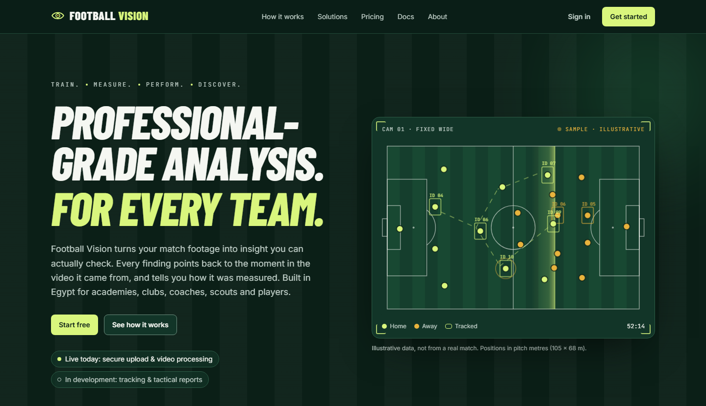

</div>

---

## Contents

- [Why Football Vision](#why-football-vision)
- [What works today](#what-works-today)
- [How it works](#how-it-works)
- [Inside the product](#inside-the-product)
- [The AI pipeline](#the-ai-pipeline)
- [Architecture](#architecture)
- [Security and privacy](#security-and-privacy)
- [Tech stack](#tech-stack)
- [Quick start](#quick-start)
- [Testing](#testing)
- [Project structure](#project-structure)
- [Roadmap](#roadmap)
- [Known limitations](#known-limitations)
- [Documentation](#documentation)
- [Acknowledgements](#acknowledgements)

---

## Why Football Vision

Professional analysis platforms are built for elite clubs with analysts, multi-camera rigs and big
budgets. Academies, grassroots clubs, coaches, scouts and players are left with video they don't
have time to break down.

Football Vision needs **one fixed, wide camera that sees the whole pitch.** You upload the match,
click four or more points on the pitch once, and the system detects, tracks and measures every
player in real pitch metres.

### Evidence, not opinions

Most analytics tools show a number and ask you to trust it. Football Vision labels every metric
with **how it was produced**, and shows nothing when the footage can't support it.

| Label | Meaning | Example |
|---|---|---|
| 🟢 **Measured** | Taken directly from calibrated tracking | Team width, back-line height |
| 🔵 **Estimated** | Built from tracking that can have gaps; shown with a quality note | Distance covered |
| 🟡 **Inferred** | A reading of the game, shown with the evidence behind it | Shape in possession |
| ⚪ **Not available** | The footage can't support it, so we say so | xG without a validated event model |

Every results page opens with a **"How reliable is this?"** panel: calibration error, people
detected per frame, how often player identities break up, and how much of the match had both team
shapes visible.

---

## What works today

Football Vision is **early-access software**. This table only lists what is built and tested.

| | Capability | State |
|---|---|---|
| 🏟️ | **Workspaces**: personal, club and academy workspaces with a switcher | ✅ Live |
| 👥 | **Team management**: 6 roles, one permission matrix, single-use email-bound invitations | ✅ Live |
| 👋 | **Onboarding by persona**: player, coach, club or academy, scout, parent; players set up their profile straight away | ✅ Live |
| 🧑 | **Player profiles**: for individual players and for every squad member; built from every match they're linked to ("This is me" / link to a squad player): average score, form chart, top speed, sprints, distance, consistent strengths and weaknesses, heatmap across matches, match log | 🟡 Beta, tested on synthetic truth |
| 🎯 | **Development plans**: priorities built from match evidence and coach ratings (each with its evidence, how sure we are, possible reasons, drills and a measurable goal); plans with up to 3 objectives, baseline → target, drills from a 23-drill training library, sessions per week; players log sessions with effort and reflections, coaches give feedback; progress keeps "training done" and "measured change" apart and only counts matches played after the plan started | 🟡 Beta |
| ⭐ | **Coach and self ratings**: 1–5 ratings for technical, tactical and defensive areas the video can't measure yet, always shown as opinions, never as measurements | ✅ Live |
| 📚 | **Training library**: starter drills for every area (steps, coaching points, progressions, success criteria, safety), plus each club's own drills | ✅ Live |
| 🏠 | **Workspace home**: next step for every match, live processing, latest results, your profile, getting-started checklist | ✅ Live |
| 📤 | **Uploads**: large match videos sent straight to private storage in signed parts | ✅ Live |
| 🎞️ | **Video checks**: format, duration and resolution probed in an isolated, time-limited process; 8 frames extracted; camera labelled fixed or moving | ✅ Live |
| 📐 | **Guided pitch calibration**: pick the pitch type (11, 9, 7/8 or 5/6-a-side), click the points asked for one at a time, plain-language accuracy, reuse a camera spot | ✅ Live |
| ⚡ | **Automatic start**: the analysis starts as soon as the pitch is marked | ✅ Live |
| 🤖 | **Detection and tracking**: RF-DETR + ByteTrack on GPU, foot points projected to pitch metres, hidden players' fragments joined | ✅ Built, tested on synthetic truth |
| 🎥 | **Moving cameras**: auto-tracking cameras followed from one calibrated frame, every placement checked against the pitch lines | 🟡 Beta: synthetic pan/zoom, plus one real broadcast clip |
| 👕 | **Team separation**: shirt colour from each player's clearest view; referees and goalkeepers kept apart | ✅ 91 % right on 170 hand-labelled real tracks |
| 🏃 | **Player reports**: physical score out of 100, strengths and weaknesses with their numbers, distance, sprints, top speed, stamina, photo, names added by staff | 🟡 Beta, tested on synthetic truth |
| 📊 | **Team results**: width, depth and line height over time, average positions, heatmaps | ✅ Built, tested on synthetic truth |
| 🧾 | **Plans and usage**: quotas reserved atomically and enforced server-side | ✅ Live |
| 🗑️ | **Deletion and retention**: match deletion (owners and admins), footage expiry, account deletion, workspace purge, audit log | ✅ Live |
| 🧭 | Automatic pitch finding (no calibration step) | 🧪 Experimental, not switched on: not yet reliable on real footage |
| 🎯 | Accuracy on real football (SoccerTrack v2 evaluation) | 🟡 Harness built, not yet run |
| ⚽ | Goals, assists, shots and passes | 🔜 Needs ball tracking |
| 🎬 | Video playback synced to the timeline | 🔜 Phase 4 |
| 💬 | "Ask your match" assistant, grounded in stored evidence | 🔜 Phase 4 |
| 💳 | Payments, PDF reports, expiring share links, email delivery | 🔜 Phase 5 |

> [!IMPORTANT]
> **Accuracy on real match footage has not been measured yet.** The pipeline is verified against a
> synthetic match with known truth (positions within 0.75 m, team width within 1 m, distance
> within 15 %). Real-footage accuracy will be published in [`docs/evaluation/`](docs/evaluation/)
> before any accuracy claim appears in the product.

---

## How it works

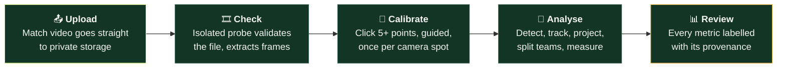

1. **Upload.** The browser uploads directly to S3-compatible storage with presigned multipart URLs.
   Each part's size is signed, and the file's first bytes are checked to confirm it is a video.
2. **Check (free).** The worker probes the video in a separate, time-limited process, extracts eight
   reference frames and labels the camera as fixed or moving. This step doesn't count against your plan.
3. **Calibrate, once per camera spot.** Pick the pitch type, then click the points the app asks for,
   one at a time, on a pitch drawing (skip what you can't see). A normalised DLT homography maps the
   image to the pitch; at least 5 points are needed so a misplaced click can't hide, each is tested
   against a fit made without it, and the result is shown in plain words ("accurate to about
   0.4 m"). Mirrored or impossible fits are rejected. Next match from the same spot: one click reuses it.
4. **Analyse (counted), automatically.** Saving the calibration starts the analysis: detection,
   tracking (fragments of a hidden player joined back together), projection, team separation and
   metrics on the GPU worker, with live progress, cancel and a timeout. A moving camera is followed
   frame by frame and checked against the pitch lines.
5. **Review.** Results open with the reliability panel, then the **Players** section (score out of
   100, strengths and weaknesses), team shape, positions and heatmaps, each labelled
   Measured / Estimated / Inferred / Not available.

---

## Inside the product

**A player's own profile**<br/>
<sub>Score out of 100, form, top speed, sprints and strengths that hold across matches; built from every match the player is linked to.</sub>

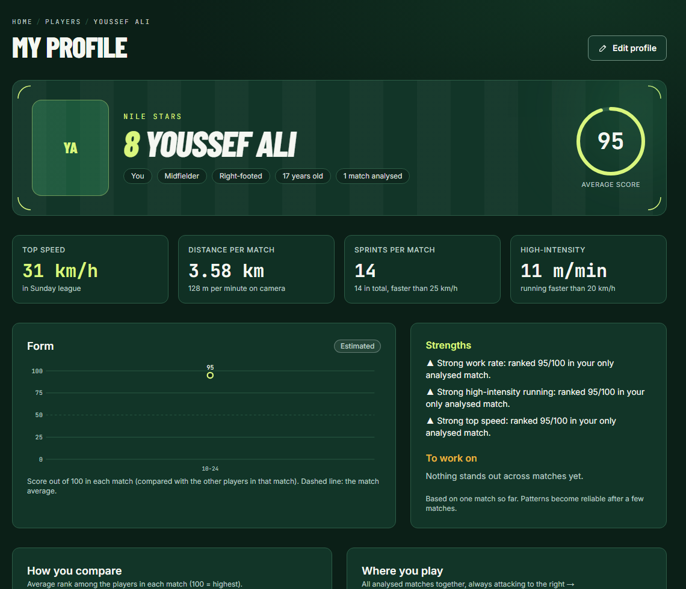

<table>
<tr>
<td width="50%" valign="top">

**Development priorities**<br/>
<sub>What to work on, with the evidence, how sure we are, possible reasons, drills and how progress will be measured.</sub>

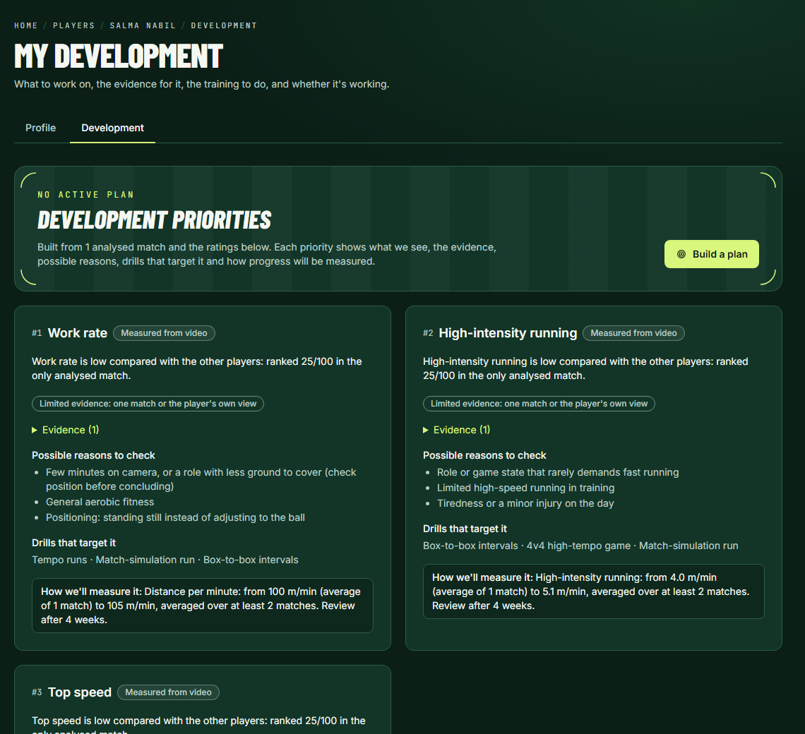

</td>
<td width="50%" valign="top">

**An active plan**<br/>
<sub>Training done and measured change tracked separately; log each session with effort and a reflection.</sub>

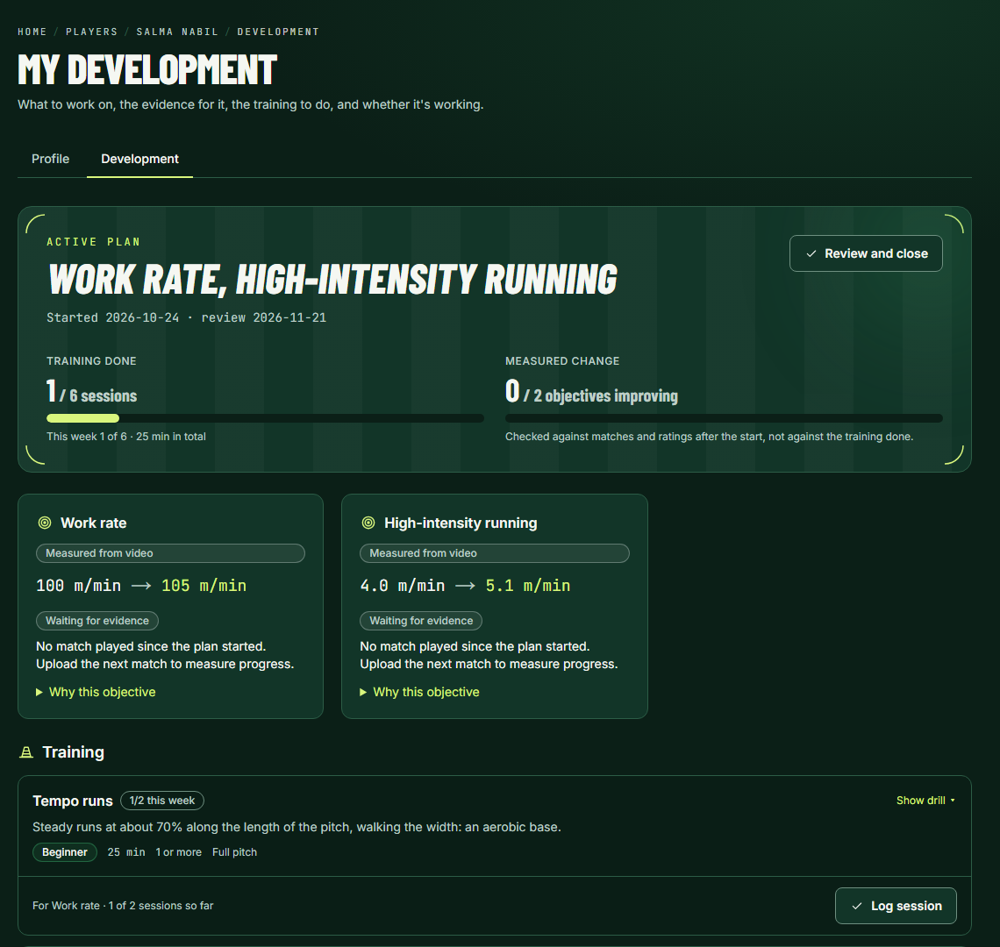

</td>
</tr>
</table>

<table>
<tr>
<td width="50%" valign="top">

**Welcome: who are you?**<br/>
<sub>Players, coaches, clubs, scouts and parents each get the right setup.</sub>

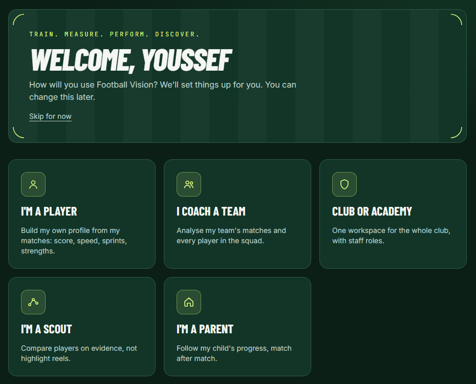

</td>
<td width="50%" valign="top">

**One player's match report**<br/>
<sub>How the score is built, strengths and what to work on; "This is me" links it to a profile.</sub>

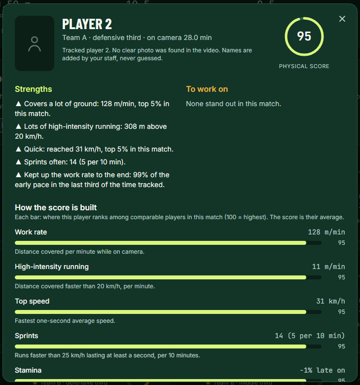

</td>
</tr>
</table>

**Workspace home**<br/>
<sub>Every match with its next step, what's processing, the latest results and filming tips.</sub>

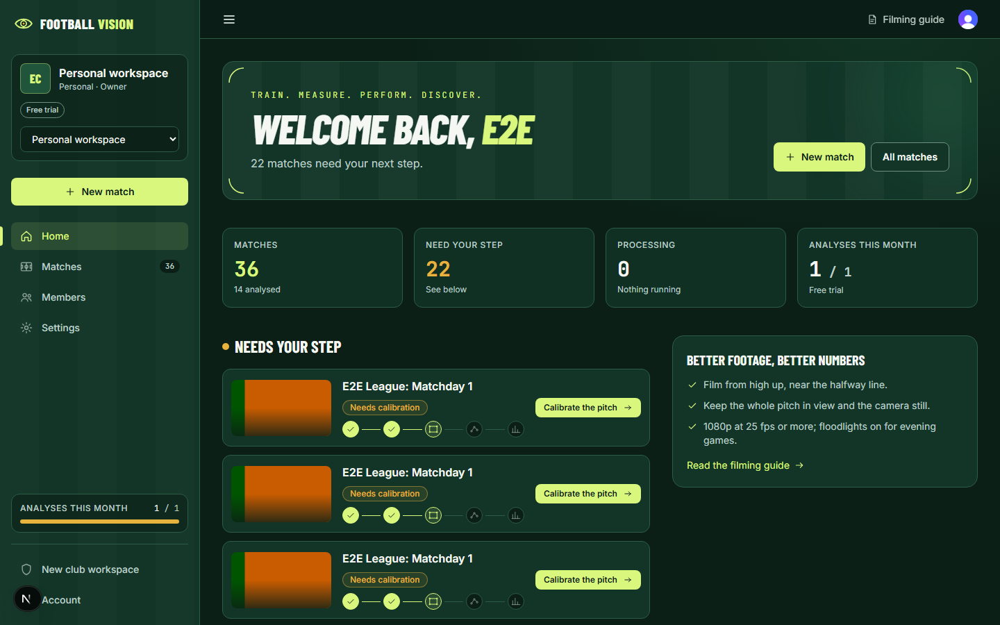

**Player reports**<br/>
<sub>A physical score out of 100 compared with the other players in the match, strengths and weaknesses that quote their numbers, and the reason when a player isn't scored.</sub>

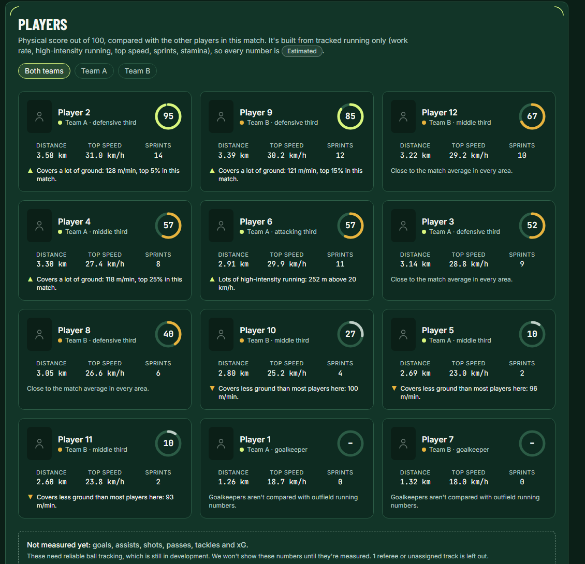

**Guided calibration**<br/>
<sub>Pick the pitch type, then click the points asked for. Green pitch lines show the fit; accuracy in plain words.</sub>

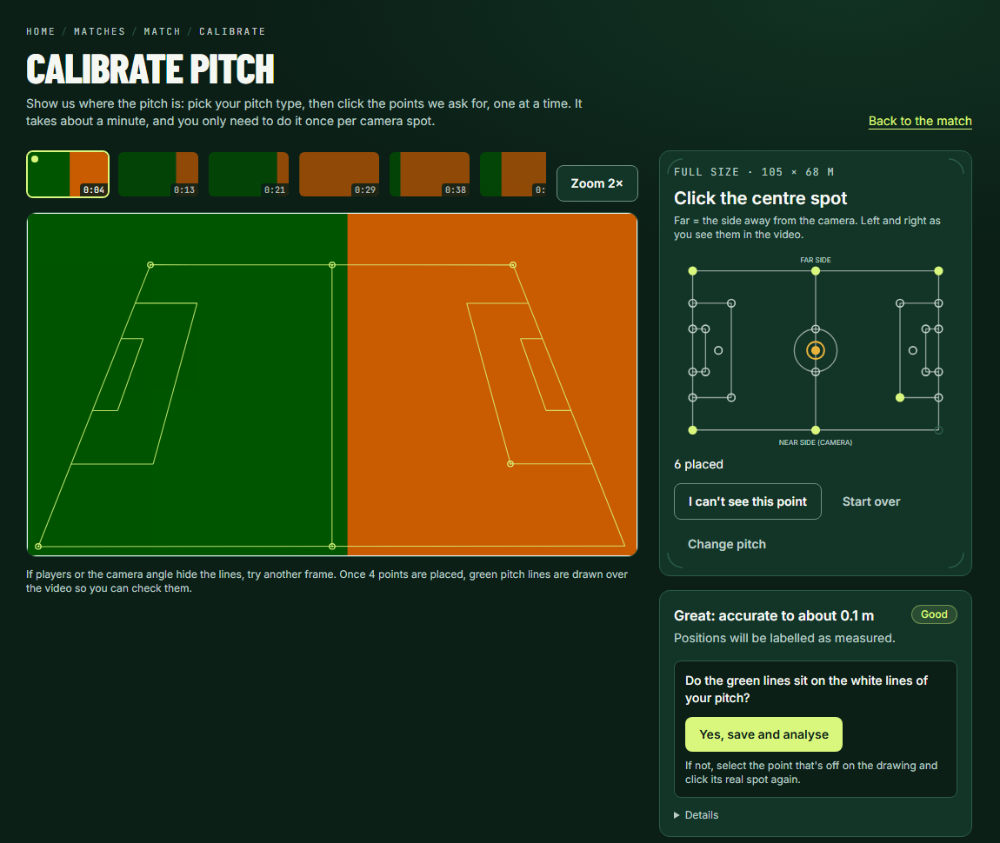

**Results: reliability panel and team shape over time**

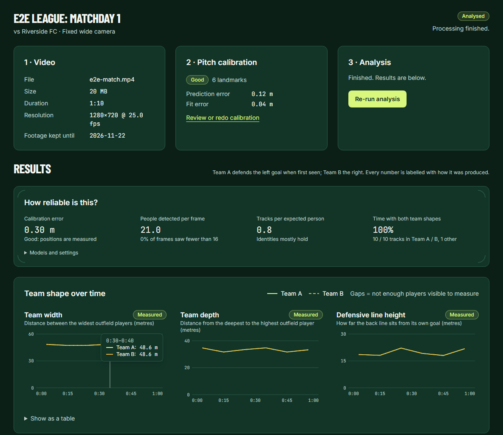

**Results: average positions and heatmap**

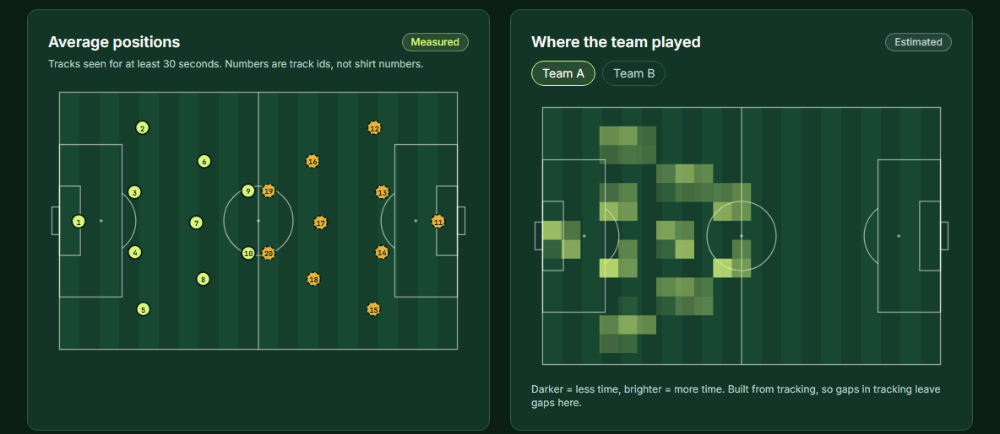

> [!NOTE]
> Results, player and profile screenshots show **synthetic test data** used for testing, not a real match or a real person.

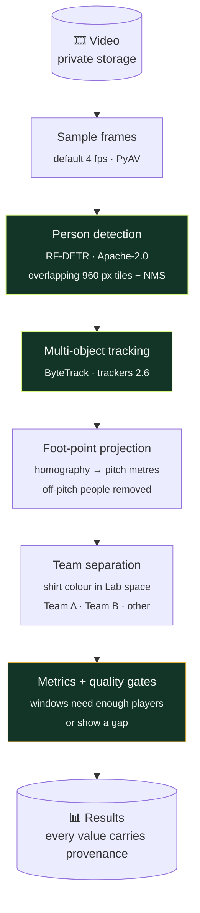

| Stage | How | Why this choice |
|---|---|---|
| **Detection** | [RF-DETR](https://github.com/roboflow/rf-detr) (Nano–Large, COCO person class) on overlapping tiles | Apache-2.0 code and weights; tiling keeps distant players large enough to detect. PML-licensed "plus" models are refused in code. |
| **Tracking** | ByteTrack from Roboflow's [`trackers`](https://github.com/roboflow/trackers) | Apache-2.0, keeps low-confidence boxes that matter in crowded penalty areas |
| **Calibration** | Normalised DLT homography, shared TypeScript code in browser and server | Same maths for the preview you see and the result that's saved; leave-one-out error gives a fair accuracy estimate |
| **Teams** | Shirt colour (Lab) from each player's clearest view; over-clustered into up to 6 colour groups; groups rarely seen several at once (referees, goalkeepers) set aside; the rest split in two | Works with any kit, no training data; measured 91 % right on 170 hand-labelled real broadcast tracks |
| **Player identity** | Track fragments joined when a hidden player reappears within 6 s at a reachable distance, same team; refused when two continuations are equally likely | One report per person; a wrong join would mix two players' numbers, so ambiguity is left apart |
| **Moving cameras** | ORB features on static scenery, keyframe bank (drift discarded when a view returns), every placement checked against the white lines on the grass; cuts and replays skipped | Auto-tracking cameras turn and zoom from one spot; nothing is placed on the pitch unless the lines confirm it |
| **Metrics** | Team width, depth, defensive-line height per window; per player: distance, high-intensity distance, sprints, top speed, stamina; heatmaps | Each one gated on enough visible players; thresholds follow the pitch format (8 of 11, 4 of 5) |
| **Player score** | Average of percentile ranks among comparable outfield players in the same match: work rate, high-intensity running, top speed, sprints, stamina | Transparent and relative; running only, no ball events, so labelled estimated |

Every analysis records the exact model, version, tile size and threshold it used, so results can
be traced and reproduced.

**Speed today:** about 0.4 s per sampled frame on a GTX 1660 Ti (RF-DETR Medium, 4 tiles, fp32),
or roughly 2.5 h for a 90-minute match at 4 fps. Production will run on cloud GPUs with tensor
cores and FP16.

---

## Architecture

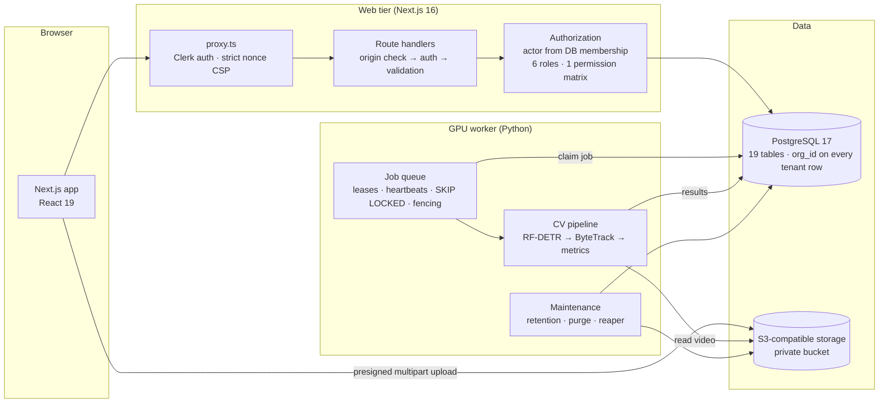

- **No queue broker to run.** Jobs live in Postgres and are claimed with `FOR UPDATE SKIP LOCKED`.
  A worker holds a lease, renews it with heartbeats, and every write is fenced, so a worker that
  lost its lease can never overwrite newer results.
- **Video never passes through the web server.** Browsers upload to storage directly; the server
  only signs URLs and checks the result.
- **Two job kinds.** A free *prepare* job (validate + reference frames) and a counted *analyze*
  job. A unique index allows only one active job per video and kind.
- **Fail closed in production.** The app refuses to start if database migrations lag the build.

Full decisions, alternatives and the threat model: [docs/ARCHITECTURE.md](docs/ARCHITECTURE.md).

---

## Security and privacy

Football Vision is built for clubs and academies that film players, **including minors**.
Security is enforced on the server, never only in the UI.

| Area | What's enforced |
|---|---|
| 🧱 **Tenant isolation** | Every tenant row carries `org_id`; the acting user's role is loaded from the database on every request; resources in other workspaces return **404**, not 403 |
| 🔐 **Authentication** | Clerk sessions; dangerous actions (deleting a workspace or account) require a sign-in within the last 10 minutes |
| 🛡️ **Content Security Policy** | Strict per-request nonce with `'strict-dynamic'`; E2E tests check every script carries a fresh nonce |
| 📤 **Uploads** | Presigned multipart with **signed part sizes**, magic-byte sniffing, size limits, idempotent completion |
| 🎞️ **Untrusted video** | Probed and decoded in an isolated, time-limited child process; Pillow kept on a patched major version |
| 🌐 **HTTP layer** | Origin check before anything else, authenticate before validating, JSON only, body size limits, safe error messages, DB-backed rate limits |
| 📮 **Invitations** | Single use, bound to an email, expire in 7 days, only a hash is stored |
| 🪝 **Webhooks** | Signature-verified and replay-safe (forged, tampered, stale and replayed deliveries all tested) |
| 🧾 **Audit log** | Workspace, member, match and account events written in the same transaction as the change |
| 🗑️ **Retention** | Footage deleted after the plan's retention period; deleted workspaces purged after 7 days; storage cleared before the database |
| 🙅 **No secret sauce on your data** | Footage is private by default and never used to train models without explicit permission |
| 🔑 **Secrets** | No credentials in the repository; local dev credentials in `infra/` are for localhost only |

Critical rules (tenant isolation, quota reservation, queue fencing, last-owner protection) are
**mutation-checked**: the protection was deliberately broken to confirm the tests fail.

---

## Tech stack

| Layer | Technology |
|---|---|
| **Web** | Next.js 16 (App Router, Turbopack), React 19, TypeScript, Tailwind CSS v4 |
| **Auth** | Clerk |
| **Database** | PostgreSQL 17, Drizzle ORM, versioned SQL migrations |
| **Storage** | S3-compatible (SeaweedFS locally), AWS SDK v3 presigner |
| **Validation and logging** | Zod 4, Pino |
| **Worker** | Python 3.13, psycopg 3, boto3, PyAV, Pillow 13, NumPy, SciPy |
| **Computer vision** | PyTorch (CUDA), RF-DETR, `trackers` (ByteTrack), supervision |
| **Testing** | Vitest, pytest, Playwright, `@clerk/testing`, axe-core |
| **CI** | GitHub Actions: typecheck, lint, tests, build, `npm audit`, `pip-audit` |
| **Design** | Barlow Condensed + Inter + JetBrains Mono; brand palette below |

<details>
<summary><b>Brand palette</b></summary>

| Role | Name | Hex |
|---|---|---|
| Background | Primary | `#0B1F17` |
| Foundational | Lush Green | `#2E8B57` |
| Signature | Mindaro | `#D9F67D` |
| Accentuation | Elite Gold | `#E8B33D` |
| Secondary foundational | Forest Green | `#123528` |
| Structural | Pitch Line | `#2C5C46` |
| Structural | Cascade | `#BFCEC7` |

Chart colours were checked for colour-blind separation; Team B is always dashed as a non-colour cue.
Details in [docs/BRAND.md](docs/BRAND.md).

</details>

---

## Quick start

**Prerequisites:** Docker Desktop, Node.js 24 LTS (npm 11), Python 3.12+. An NVIDIA GPU is
recommended for analysis (CPU works, slowly).

```bash
# 1. Infrastructure: Postgres on 127.0.0.1:5433, S3 on 127.0.0.1:8333
docker compose up -d

# 2. Web app
cd web
cp .env.example .env          # used by tests and scripts
cp .env.example .env.local    # used by `next dev`; add your Clerk keys here
npm install
npm run db:migrate
npm run dev                   # → http://localhost:3000

# 3. Worker (separate terminal)
cd worker
python -m venv .venv
.venv/Scripts/python -m pip install -e ".[dev]"     # Windows; use .venv/bin/python elsewhere
# Computer vision: install PyTorch for your platform first, then the extras
.venv/Scripts/python -m pip install torch torchvision --index-url https://download.pytorch.org/whl/cu126
.venv/Scripts/python -m pip install -e ".[cv,eval]"
cp .env.example .env
.venv/Scripts/python -m fa_worker.main              # add --once to drain the queue and exit
```

<details>
<summary><b>Authentication keys (Clerk)</b></summary>

Sign-in needs Clerk keys in `web/.env.local`. Create an application at
[dashboard.clerk.com](https://dashboard.clerk.com) and paste its development keys.

For quick local trials, temporary keys for an unclaimed development app can be created without an
account. **Don't run `clerk init` inside this repo**: it rewrites `src/proxy.ts` and the auth
pages. Run it in an empty scratch Next.js project and copy only the `*CLERK*` lines.

To enable the Clerk webhook, add an endpoint for `https://<your-domain>/api/webhooks/clerk`
(events `user.deleted`, `user.updated`) and set `CLERK_WEBHOOK_SIGNING_SECRET`.

</details>

<details>
<summary><b>Give a staff account unlimited testing</b></summary>

The `internal` plan is not sold or billed. It is assigned with an audit event:

```bash
cd web && npx tsx scripts/grant-plan.mts --email <address> --plan internal
```

</details>

---

## Testing

Results of the latest full run (2026-10-24):

| Suite | Count | What it covers |
|---|---:|---|
| **Web unit + integration** (Vitest) | **157** | Permissions, tenancy, members, invitations, quota, uploads (real S3), rate limits, HTTP layer, webhooks, homography and plausibility, calibration (formats, moving cameras, reuse), match deletion, player reports, player profiles (aggregation, linking, latest-analysis rule, tenancy), onboarding, development plans (priorities, baselines computed on the server, plan limit under concurrent requests, players logging only their own plan, follow-up evidence rules, club drills kept inside their workspace), results, migrations |
| **Worker** (pytest) | **90** | Queue leases and fencing, video validation and camera labelling, pipeline, maintenance (incl. photo purge), tracking and fragment joining, team separation, running profiles, camera following (pan/zoom, cuts, line checks), moving-camera analysis, automatic calibration safety, synthetic-match accuracy, evaluation scoring |
| **Browser end-to-end** (Playwright) | **24** | Real sign-in, upload → automatic analysis start → results with a real RF-DETR run on the GPU, guided calibration, a new player's sign-up → profile → "This is me" → profile filled in, development priorities → plan → session logged → reflection → self rating, squad linking, match deletion, two-user team flows, account deletion, phone navigation, CSP headers, axe accessibility scans |

All passed first try, the production build passes, and `pip-audit` is clean.

```bash
cd web && npm run check                         # typecheck, lint, tests, production build
cd worker && .venv/Scripts/python -m pytest     # worker tests
cd web && npx playwright install chromium       # first time only
cd web && npm run e2e                           # browser tests (needs Clerk keys + worker venv)
```

Integration tests need `docker compose up -d`. They use separate databases and a separate bucket,
so they never touch development data.

<details>
<summary><b>Pipeline smoke test without a browser</b></summary>

```bash
cd web && npx tsx scripts/smoke-pipeline.mts path/to/video.mp4
cd ../worker && .venv/Scripts/python -m fa_worker.main --once
cd ../web && npx tsx scripts/smoke-pipeline.mts --status <matchId>
```

</details>

---

## Project structure

```
football_vision/
├── web/                         Next.js app: marketing site, product, API
│   ├── src/app/(marketing)/     Landing, solutions, pricing, docs, FAQ, legal
│   ├── src/app/app/[org]/       Matches, calibration, results, members, settings
│   ├── src/app/api/             Route handlers (orgs, matches, uploads, jobs, webhooks)
│   ├── src/server/              Server-only logic: auth, authz, billing, jobs, storage, audit
│   ├── src/lib/pitch/           Pitch landmarks + homography (shared browser/server)
│   ├── drizzle/                 Versioned SQL migrations
│   ├── e2e/                     Playwright journeys
│   └── test/                    Vitest unit + integration tests
├── worker/                      Python GPU worker
│   ├── fa_worker/queue.py       Leases, heartbeats, fencing
│   ├── fa_worker/stages/        Isolated video validation + frame extraction
│   ├── fa_worker/analysis/      Detector, tracker, teams, geometry, metrics
│   ├── fa_worker/eval/          SoccerTrack v2 evaluation harness
│   └── tests/                   pytest suite
├── docs/                        Architecture, status, brand, evaluation
├── infra/                       Local-only infrastructure config
└── docker-compose.yml           Postgres 17 + S3-compatible storage
```

---

## Roadmap

| Phase | Scope | State |
|---|---|---|
| **1 · Foundation** | Architecture, data model, auth, CI, infrastructure | ✅ Done |
| **2 · Core SaaS** | Workspaces, roles, invitations, uploads, quotas, retention, audit, account deletion | ✅ Done |
| **3 · First AI slice** | Calibration, detection, tracking, teams, team-shape metrics, results UI, evaluation harness | ✅ Built · 🟡 real-footage accuracy pending |
| **4 · Analytics** | Player reports and profiles, development plans and training library, team separation, moving cameras (done, beta); player ownership and consent with academies, academy dashboards, scouting (next, see [platform plan](docs/PLATFORM_PLAN.md)); automatic pitch finding, ball tracking, video playback synced to the timeline, "Ask your match" | 🟡 In progress |
| **5 · Commercial** | Payment provider, PDF reports, expiring share links, email delivery | 🟡 Plans and limits enforced; payments not connected |
| **6 · Production** | Hardened containers, least-privilege DB roles, deployment, backups with restore drills, monitoring | 🟡 Strict CSP, CI and migration guard in place |

---

## Known limitations

We'd rather you hear these from us:

- **Real-footage accuracy is unmeasured.** It will be published before it is claimed.
- **The pitch is still marked by hand, once per camera spot.** Automatic pitch finding exists as an
  experiment but isn't reliable on real footage yet, so it's switched off.
- **Moving cameras are in beta.** A camera that turns and zooms from one spot (auto-tracking cameras)
  is followed from one calibrated frame and checked against the pitch lines; it's verified on
  synthetic footage and one broadcast clip, not yet on real auto-tracking recordings. Handheld footage
  isn't supported, and a TV broadcast is only analysed for the shot you calibrate.
- **The player score is about running, not playing well.** It compares players within one match from
  tracking only. Goals, assists, shots and passes aren't measured yet (they need ball tracking).
- **Goalkeepers are left out of teams** (their kit differs), so they don't get player cards yet.
- **Identity switches** split one player into several tracks; the reliability panel reports how often.
- **Teams are named A and B** (A defends the left goal when first seen); you can't yet mark which is yours.
- **Processing is slow on consumer GPUs** (about 2.5 h per match on a GTX 1660 Ti).
- Invitation emails aren't sent automatically yet; the inviter shares the link.

The full list, with technical debt, is in [docs/STATUS.md](docs/STATUS.md).

---

## Documentation

| Document | Contents |
|---|---|
| [docs/ARCHITECTURE.md](docs/ARCHITECTURE.md) | System design, decisions and alternatives, data model, threat model |
| [docs/STATUS.md](docs/STATUS.md) | What works (with test evidence), what's missing, limitations, manual setup |
| [docs/evaluation/](docs/evaluation/) | How accuracy is measured, and the results once available |
| [docs/BRAND.md](docs/BRAND.md) | Colours, typography, chart palette validation |

---

## Acknowledgements

- [RF-DETR](https://github.com/roboflow/rf-detr) and [trackers](https://github.com/roboflow/trackers)
  by Roboflow (Apache-2.0).
- Evaluation uses **SoccerTrack v2** (CC BY 4.0): Scott et al., *SoccerTrack v2*,
  [arXiv:2508.01802](https://arxiv.org/abs/2508.01802). The dataset isn't included in this repository.

## Licence

© 2026 Football Vision. All rights reserved. This source is published for viewing; no licence to
use, copy, modify or distribute it is granted unless stated otherwise in writing.

<div align="center">
<br/>

**Built in Egypt 🇪🇬 for every team.**

<sub>Train. · Measure. · Perform. · Discover.</sub>

</div>
